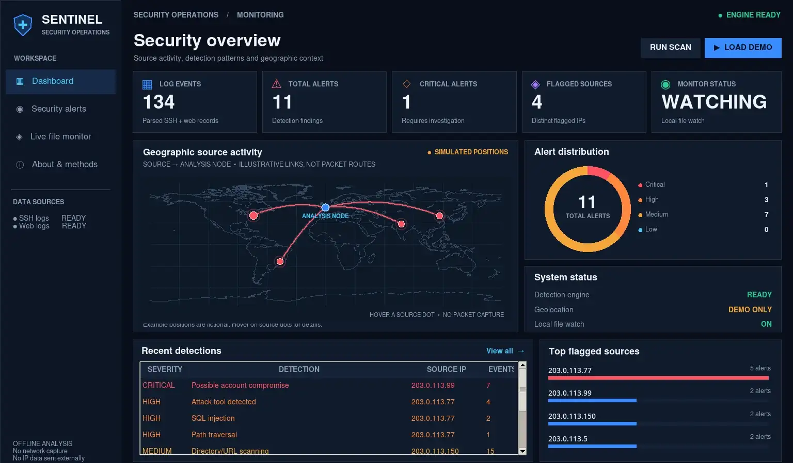

# SENTINEL — Security Log Analyser

**Final desktop interface | Python · Tkinter · Blue-team log analysis · Optional local GeoIP**

SENTINEL is a dark, SOC-inspired desktop dashboard that uses the **real detection engine in `log_analyser.py`**. It analyses SSH authentication and web access logs, displays triage findings and severity breakdowns, and maps IP locations **only when the geographic information is supplied**. The original command-line analyser remains usable.



*Actual screenshot from a virtual desktop. The source positions in the screenshot are explicitly simulated and the source IPs are reserved documentation addresses. No live Internet attacks or active security infrastructure are represented.*

## Start on macOS

Download and extract the **latest repository ZIP** or update your local checkout. Then run:

```bash
cd ~/Downloads/Security-Log-Analyser-main
python3 gui_dashboard.py
```

Requires **Python 3.10+ with Tkinter**. The base application has no non-standard dependencies. You can check Tkinter with `python3 -m tkinter`.

1. Click **LOAD DEMO** to generate safe synthetic SSH and web logs into a temporary directory and analyse them.
2. Explore the Dashboard, **Security alerts**, **Live file monitor**, and **About & methods** tabs.
3. Hover red map markers for a source IP and its **fictional demo position**.
4. On the Alerts page, search or filter by severity, then export JSON or CSV.
5. To work with your own log files, open **Live file monitor** and select local SSH/web logs. Press **RUN SECURITY SCAN**.

The sample data produces **55 SSH events + 79 web requests = 134 events**, with **11 alerts** (1 critical, 3 high, 7 medium) across four synthetic source IPs.

## Geographic connections — what the map actually shows

The world outline is bundled as a **simplified, offline coastline dataset derived from Natural Earth** (public-domain map data). Its connection arcs visually link mapped sources with an **illustrative analysis node**. They are **not captured packet flows, verified communication routes, or true destination locations**.

- **Demo data:** Predefined, fictional world positions for reserved example IP addresses (`203.0.113.0/24`), visibly labelled **SIMULATED POSITIONS**. These do not represent where those IPs originate.
- **Real logs:** By default, no locations are plotted. The application never guesses a country or city from the IP string. To plot public IPs, install `geoip2` and supply your own local GeoLite2 City-compatible `.mmdb` file using **LOAD LOCAL .MMDB DATABASE** on the Live File Monitor page:

  ```bash
  python3 -m pip install geoip2
  ```

  The application only accesses the local database; **it does not transmit IP addresses to an Internet geolocation API**. GeoIP locations are approximate and are not proof of a person's identity or of an attack. Private, reserved, and unknown IPs are omitted.

## Live file monitoring (not network capture)

On the **Live file monitor** page:

1. Choose one or two existing local log files.
2. Press **RUN SECURITY SCAN** to analyse them.
3. Click **ENABLE FILE WATCH** to reanalyse the file contents whenever their modification time/size changes (checked about every 1.5 seconds).
4. Click **DISABLE FILE WATCH** to stop watching.

This is **near-real-time local-file monitoring**, not direct network telemetry, packet capture, or a SIEM connected to production infrastructure. The map updates when the underlying detection findings change and valid coordinates are available.

## Detection quality and regression evidence

SENTINEL now includes a **27-scenario labelled synthetic regression benchmark** with benign and suspicious cases separate from the original demo logs. Before the changes, **23/27 scenarios** matched the expected alert categories and **2/14 benign scenarios** raised unwanted alerts. After tightening URL encoding, sensitive-file matching and 404-scan handling, **27/27 scenarios matched** with **0/14 benign scenarios flagged**. The expanded automated suite includes **24 tests**.

These are **regression results on deliberately constructed examples**, **not real-world detection accuracy**. Read [BENCHMARK.md](BENCHMARK.md) for methodology, limitations and before/after evidence.

```bash
python3 benchmark_detection.py --json benchmark_results.json
python3 -m unittest discover -v
```

## Command-line analyser and tests

The original CLI and detection rules are preserved:

```bash
python3 log_analyser.py --ssh auth.log --web access.log --year 2026 --json report.json
python3 -m unittest discover -v
```

The suite includes **12 original detection tests**, **4 map/location helper tests** and **8 detector-regression/benchmark tests** (**24 total**), covering IP filtering and fictional-versus-real map placement. A virtual-desktop smoke test also confirmed startup, demo loading, map drawing, alert filters, tab navigation and file-watch controls. On macOS the exact rendering may vary.

## Detection coverage

| Input | Detection method | ATT&CK context |
| --- | --- | --- |
| SSH | Repeated failed logins in a sliding time window | [T1110](https://attack.mitre.org/techniques/T1110/) |
| SSH | Multiple usernames targeted within the same window | [T1110](https://attack.mitre.org/techniques/T1110/) |
| SSH | Successful login following failures for the **same IP and username** | [T1078](https://attack.mitre.org/techniques/T1078/) |
| Web | SQL injection, traversal and XSS-related request signatures | [T1190](https://attack.mitre.org/techniques/T1190/) |
| Web | Sensitive-file probes, 404 bursts, known scanning User-Agents | [T1595](https://attack.mitre.org/techniques/T1595/) |

These mappings are classification aids, not evidence that the named technique was definitively used.

## Repository structure

```text
gui_dashboard.py                 # Final Tkinter SOC dashboard
log_analyser.py                  # Existing CLI + detection engine
assets/world_coastline.json      # Bundled offshore coastline geometry
screenshots/sentinel_final_dashboard.webp
generate_sample_logs.py          # Writes synthetic data into current directory
archived synthetic auth.log / access.log
report.json                      # Example CLI output
test_log_analyser.py             # 12 core tests
test_dashboard_helpers.py        # 4 map/IP safety tests
benchmark_detection.py            # Curated synthetic scenarios and metrics
test_detection_benchmark.py       # 8 detector regression / benchmark tests
BENCHMARK.md                      # Benchmark methodology and limitations
evidence/                        # Before/after benchmark summaries
CHANGELOG.md
```

## Boundaries and limitations

SENTINEL is an educational **offline defensive** tool. It cannot verify a breach from log patterns alone; can miss unfamiliar threats or produce false positives; currently parses common IPv4 SSH and web formats; reads files into memory rather than streaming huge archives; and does **not** automatically block addresses or perform security scans against external systems. The optional file watch only triggers rescans of selected local files.

**Privacy:** Only analyse data you own or are authorised to inspect. Do not publish real credentials, personal IP logs, private session data, or unredacted production data.