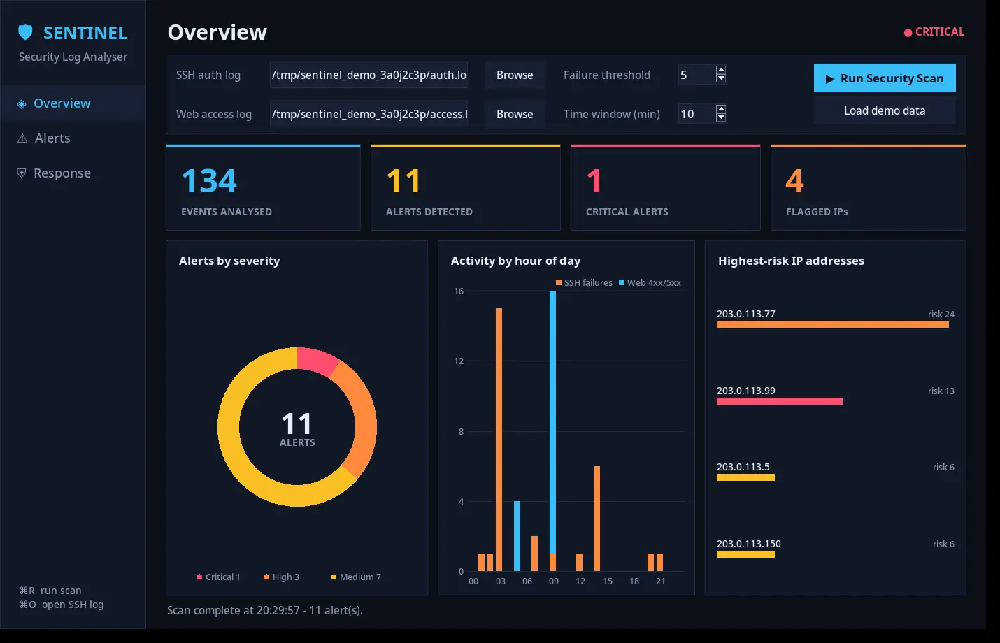

# SENTINEL — Security Log Analyser

**Final Desktop Application · Python · Tkinter · Blue-Team Detection Engineering**

**SENTINEL is the main graphical interface** for this project. It lets you select SSH and web logs, analyse suspicious activity, explore alerts and severity charts, review potential defensive responses, and export reports. The original Python **command-line analyser remains available** for scripting, learning and repeatable testing.

> **Offline defensive project:** SENTINEL does not scan networks, connect to remote systems, block addresses automatically, or establish that an account is compromised. The included logs are synthetic demonstration data.



*Final SENTINEL desktop interface, captured in a virtual desktop using the included synthetic demonstration logs. Mac appearance may vary.*

## Run SENTINEL on macOS

**Requirements:** Python 3.10+ with Tkinter. No other third-party packages are required.

1. [Download the entire project ZIP](https://github.com/k1ngXravioli/Security-Log-Analyser/archive/refs/heads/main.zip) and double-click it to extract.
2. Open **Terminal** and run:

```bash
cd ~/Downloads/Security-Log-Analyser-main
python3 gui_dashboard.py
```

3. Click **Load demo data** for an instant working example.
4. Use **Overview** to inspect metrics/charts, **Alerts** to search/filter and inspect detections, and **Response** for **review-only** example firewall commands.
5. To analyse log files that you own or have permission to inspect, use the file chooser and click **Run Security Scan**. JSON and CSV export are available on the Alerts page.

If Tkinter does not open, check with `python3 -m tkinter` and use a Python installation with Tk support.

### Verified demo

The included synthetic sample contains **55 SSH events and 79 web requests**, producing **11 alerts** (1 critical, 3 high, 7 medium) across four documentation IP addresses. The underlying analyser passes **12 automated tests**. A virtual-desktop smoke test confirmed that the GUI opened, loaded demo data, displayed the 11 alerts, filtered/searched results, switched tabs, and exported matching JSON/CSV reports. This is **not a claim of testing on every macOS version**.

## Original command-line analyser

For direct Python / terminal analysis, run:

```bash
python3 -m unittest discover -v
python3 log_analyser.py --ssh auth.log --web access.log --year 2026 --json report.json
```

To regenerate the sample files, use `python3 generate_sample_logs.py` (**overwrites existing `auth.log` and `access.log` in that folder**).

## Detection coverage

| Input | Detection | How it works | MITRE ATT&CK reference |
| --- | --- | --- | --- |
| SSH | Repeated failed logins | A sliding window counts failures per source IP | [T1110](https://attack.mitre.org/techniques/T1110/) |
| SSH | Multiple usernames targeted | Counts distinct attempted usernames from the same IP **within the window** | [T1110](https://attack.mitre.org/techniques/T1110/) |
| SSH | Successful login after failures | Matches an accepted login to recent failures for the **same IP and username** | [T1078](https://attack.mitre.org/techniques/T1078/) |
| Web | SQL injection, path traversal and XSS patterns | Matches known indicators in requested URL paths | [T1190](https://attack.mitre.org/techniques/T1190/) |
| Web | Sensitive-file probes and 404 bursts | Detects reconnaissance-style requests and repeated not-found responses | [T1595](https://attack.mitre.org/techniques/T1595/) |
| Web | Known scanner User-Agent strings | Flags strings such as `sqlmap` and `nikto` | [T1595](https://attack.mitre.org/techniques/T1595/) |

The ATT&CK mappings provide context. They **do not prove** which attack technique was used. In particular, SSH failure logs alone cannot demonstrate password spraying, since they do not show the passwords attempted.

## Command options

```text
--ssh FILE          SSH syslog-format authentication log
--web FILE          Web server combined-format access log
--threshold N       Failed-login count per time window (default: 5)
--window MINUTES    Window size in minutes (default: 10)
--year YYYY         Year to attach to SSH syslog timestamps
--json FILE         Save alerts as JSON as well as displaying them
```

At least one log input is required. Threshold and window must be positive integers.

## Implementation

- **SENTINEL Tkinter GUI** — accessible desktop navigation, severity metrics and charts, tabular alerts, details, offline demo-data loading and JSON/CSV exports. The interface calls the existing Python detection engine.

- Regex-based parsing extracts timestamps, IPs, account names, HTTP paths, status codes and User-Agent strings.
- **Sliding-window logic** finds failure bursts and clusters of distinct usernames within a chosen time range.
- **Cross-event correlation** checks whether an accepted SSH login follows failures for the same IP and username.
- Alerts carry category, severity, source, count, first/last timestamps and a contextual MITRE ATT&CK identifier.
- JSON export uses the same severity ordering as the printed report.
- Twelve automated tests cover the main detections and edge cases, including false-positive regression scenarios.

## Known limitations

- Heuristic and signature-based detection can yield false positives or miss unfamiliar and obfuscated attack patterns.
- SSH parser assumes common `sshd` syslog messages with IPv4 addresses; IPv6 and other auth formats are not yet supported.
- SSH syslog entries usually omit the year; use `--year` to specify it. Logs spanning a year boundary require preprocessing.
- Parsing reads log files into memory, so very large production archives may need a streaming approach.
- Missing or malformed entries can reduce detection coverage; the tool is not a replacement for a managed security monitoring platform.
- The sample results are from generated data, not a deployed network or production incident.

## Project files

- `gui_dashboard.py` — **final SENTINEL desktop application**; run this to open the graphical interface
- `log_analyser.py` — underlying detection engine and CLI report generator
- `test_log_analyser.py` — automated tests
- `generate_sample_logs.py` — deterministic synthetic test data generator
- `auth.log`, `access.log` — example logs
- `report.json` — example structured alert output
- `screenshots/sentinel_dashboard_preview.webp` — screenshot of the final interface
- `CHANGELOG.md` — source-review improvements